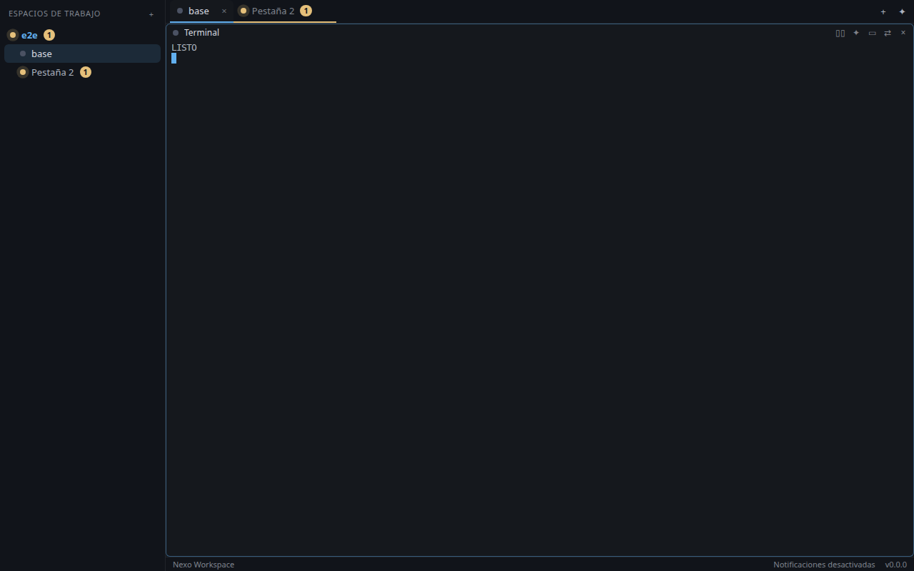

# Arquitectura de Nexo Workspace

Nexo Workspace (`nexo`) es una app de escritorio (Linux y Windows) para trabajar con varios agentes de programación
(Claude Code, Codex, Gemini, Antigravity, modelos locales) y terminales reales en pestañas y paneles,
al estilo de un multiplexor. Este documento es el **contrato** del proyecto: si el código y este
documento no coinciden, se corrige uno de los dos en el mismo PR.

Las decisiones con su porqué están en [`docs/adr/`](adr/). El plan por fases, en [`ROADMAP.md`](ROADMAP.md).

## Objetivos (en orden de prioridad)

1. **Rápida:** cambiar de pestaña o de panel en menos de un cuadro (16 ms), sin recargar nada; el texto
   del agente se ve en cuanto llega.
2. **Una sola fuente de verdad:** el daemon. La ventana, la CLI y el servidor MCP son clientes iguales.
   Cerrar la ventana no mata agentes ni terminales.
3. **Probada:** cada parte tiene pruebas unitarias, de contrato y adversariales.
4. **Extensible:** agregar un proveedor de agente, un tipo de panel o un cliente nuevo (p. ej. la mascota)
   no toca el núcleo.

## Procesos

```
┌──────────────────────────┐       spawn / vigila        ┌──────────────────────────────────┐
│ apps/desktop (Tauri 2)   │ ──────────────────────────▶ │ apps/daemon (Node 24, TS)        │
│ Rust delgado: ventana,   │                             │ raíz de composición:             │
│ bandeja, atajo global,   │   WebView (WebView2 /       │ core + adaptadores               │
│ instancia única          │   WebKitGTK) carga apps/web │ HTTP + WebSocket en 127.0.0.1    │
└──────────────────────────┘            │                └──────────────────────────────────┘
                                        │ WS + token               ▲            ▲
                             ┌──────────▼─────────┐     WS + token │            │ WS + token
                             │ apps/web (SolidJS) │                │            │
                             └────────────────────┘      ┌─────────┴──┐   ┌─────┴───────┐
                                                         │ apps/cli   │   │ apps/mcp    │
                                                         │ `nexo`  │   │ stdio MCP   │
                                                         └────────────┘   └─────────────┘
                                         daemon ─ spawn ─▶ PTYs (shells) y CLIs de agentes
```

- **Daemon** (`apps/daemon`): dueño de todo el estado (espacios, pestañas, paneles, terminales, agentes).
  Escucha solo en `127.0.0.1`, exige un token aleatorio y comprueba el `Origin`. Si ya hay uno vivo,
  los clientes lo reutilizan.
- **Descubrimiento:** el daemon escribe `daemon.json` (`{ version, port, pid, startedAt }`) y `token`
  (permisos 600) en el directorio de estado:
  Linux `$XDG_STATE_HOME/nexo` (o `~/.local/state/nexo`), Windows `%LOCALAPPDATA%\Nexo`.
- **Shell de escritorio** (`apps/desktop`): solo ventana, bandeja, atajo global, instancia única y arrancar
  el daemon si no está vivo. Le pasa a la página el puerto y el token por un comando de Tauri.
  No contiene lógica de negocio: se compila pocas veces.
- **Web** (`apps/web`): la misma interfaz sirve dentro de Tauri y en un navegador (modo desarrollo o
  `nexo open --browser`).

## Capas (hexagonal)

```
packages/contracts   esquemas zod del protocolo y del dominio compartido (sin dependencias de runtime)
        ▲
packages/core        dominio + casos de uso + puertos (interfaces). Sin Node, sin I/O.
        ▲
packages/adapters/*  implementan los puertos: pty-node, pty-host, provider-claude, provider-codex, provider-acp,
                     provider-antigravity, provider-ollama, store-fs, notifier, fs-sandbox, ...
        ▲
apps/*               raíces de composición: daemon (une core + adaptadores), web, cli, mcp, desktop
```

**Regla de dependencias** (la comprueba `dependency-cruiser` en CI):

- `contracts` no importa nada del repo.
- `core` importa solo `contracts`. Nada de `node:*`, `fs`, `child_process`, `process`, ni del DOM.
- `adapters/*` importan `core` y `contracts`; nunca otro adaptador ni una app.
- `apps/*` importan lo que necesiten; ninguna app importa a otra.
- `packages/client` (SDK tipado del protocolo) lo usan `web`, `cli` y `mcp`; solo importa `contracts`. Su núcleo
  funciona en navegador/WebView y Node (sin `node:*`); lo específico de Node vive en el subpath
  `@nexo/client/node` (único lugar con `node:*` y `zod` permitidos, ver `tools/depcruise/rules.mjs`).

### Dominio (core)

| Concepto       | Qué es                                                                                                                                                                                                                                                              |
| -------------- | ------------------------------------------------------------------------------------------------------------------------------------------------------------------------------------------------------------------------------------------------------------------- |
| `Workspace`    | Grupo de pestañas, normalmente una carpeta de proyecto (`cwd`).                                                                                                                                                                                                     |
| `Tab`          | Una pestaña: su contenido es un **árbol de distribución** de paneles.                                                                                                                                                                                               |
| `Layout`       | Árbol inmutable: hoja = panel; nodo = división `row`/`column` con proporciones que suman 1.                                                                                                                                                                         |
| `Pane`         | Panel. `kind`: `terminal` o `agent` (más adelante `viewer`).                                                                                                                                                                                                        |
| `Terminal`     | Proceso en un PTY con un búfer circular de salida (para reconectar y para `terminal.read`).                                                                                                                                                                         |
| `AgentSession` | Conversación con un proveedor; su contenido es una lista de `Block` (documento).                                                                                                                                                                                    |
| `Block`        | Pieza del documento, con `id`, `index` y `turn` estables: mensaje del usuario, texto del agente (Markdown), razonamiento, acción plegable (leer, editar con diff, ejecutar con salida, buscar, otra), permiso, pregunta, plan, error, uso del turno. Ver «Agentes». |
| `Attention`    | Estado visible en la barra: `idle`, `working`, `needs-input`, `done`, `error`.                                                                                                                                                                                      |

### Puertos (interfaces en `core/ports`)

`PtyPort`, `AgentProviderPort` (ver «Agentes»), `SessionStorePort`, `EventBusPort`, `ClockPort`, `IdPort`,
`NotifierPort`, `FileSystemPort`, `LoggerPort`, `ProcessLauncherPort`. Cada puerto tiene en
`packages/testkit` un **falso** en memoria y una **suite de conformidad** que se ejecuta contra el falso
y contra cada adaptador real: así el falso no miente.

### Servicios de core (F1.2)

Todo en `packages/core`, sin I/O; el daemon (F1.3) solo los conecta con adaptadores reales.

- `LayoutService` es el único dueño del estado de espacios, pestañas y paneles (y valida que `IdPort` no
  repita ids). `WorkspaceService` lo envuelve para `workspace.*`, `tab.*` y `pane.*`: cerrar un panel, una
  pestaña o un espacio mata sus terminales (`SIGKILL`), así que nunca hay terminales sin panel.
- `TerminalService`: una terminal viva por panel como máximo. Si el proceso termina, la terminal queda legible
  (`terminal.read`) hasta que se cierre el panel o se lance otra en él. Límites configurables: terminales vivas
  (`CONFLICT` al excederlas) y escrituras por ventana deslizante sobre `ClockPort` (`RATE_LIMITED`, con
  `data.retryAfterMs`). `PtySpawnError` se mapea así: `EXECUTABLE_NOT_FOUND` y `CWD_NOT_FOUND` → `NOT_FOUND`,
  `INVALID_OPTIONS` → `INVALID_PARAMS`, el resto → `INTERNAL`. Escribir o redimensionar una terminal terminada es
  `CONFLICT`.
- Salida: `RingBuffer` (2 MiB por omisión, offset absoluto en bytes) + `OutputBatcher` (~8 ms o 64 KiB; al terminar
  el proceso se vacía lo pendiente antes de `terminal.exit`). Los pares sustitutos partidos entre trozos se unen
  antes de contar bytes, así los offsets de `terminal.output` y de `terminal.read` coinciden. El título (OSC 0/2,
  saneado, máx. 256) sale como `pane.title` sin emitir `layout.changed`.
- `SnapshotService` resuelve `snapshot` y `daemon.info`; el `seq` lo aporta el daemon.
- `createDispatcher(services)`: despachador puro `{ method, params }` (ya validados con zod) → resultado o
  `{ code, message }`. La tabla es exhaustiva sobre `METHOD_NAMES` (si falta un método no compila). Un error que
  no es de dominio sale como `INTERNAL` sin su mensaje. `events.subscribe` depende de la conexión, por eso lo
  aporta quien despacha.
- `workspace.changed` cubre lo que `layout.changed` no dice: alta, renombre y cierre de espacios y alta, cierre,
  renombre y movimiento de pestañas. Lleva el espacio con sus pestañas resumidas (`{ id, title }`, sin distribución
  ni paneles) o `{ workspaceId, removed: true }` al cerrar el espacio. Un movimiento entre espacios emite uno por
  cada espacio afectado.

### Servidor del daemon (F1.3)

`apps/daemon` (`pnpm --filter @nexo/daemon start`, Node 24 ejecuta el TS directamente) compone core con
`@nexo/adapter-pty-node`, `@nexo/adapter-pty-host` y adaptadores propios en `apps/daemon/src/adapters/` (reloj real, `UuidIds` con
`crypto.randomUUID`, bus en memoria, logger JSON con redactor de secretos).

- **Entorno** (validado con zod al arrancar): `NEXO_PORT` (4317; 0 = efímero), `NEXO_DEV`, `NEXO_STATE_DIR`,
  `NEXO_LOG_LEVEL`, `NEXO_MAX_CONNECTIONS` (128), `NEXO_AUTH_TIMEOUT_MS` (5000), `NEXO_PTY_MODE` (`host` | `direct`; por omisión
  `host` en Windows y `direct` en Linux/macOS), `NEXO_AGENT_PROVIDERS` y `NEXO_CLAUDE_EXECUTABLE` (ver «Agentes en el daemon (F2.4)»).
- **PTY aislados (issue #15, ADR 0004).** En modo `host`, node-pty corre en un proceso hijo (`@nexo/adapter-pty-host`, `child_process.fork` + IPC con
  mensajes zod validados en ambos extremos). Si el código nativo de ConPTY se cae, muere solo el host: cada terminal afectada recibe
  `terminal.exit` con `signal: "HOST_CRASH"` (y `exitCode` null), el daemon sigue vivo y el host se relanza para las terminales nuevas con
  backoff exponencial y un tope (5 caídas rápidas seguidas abren el circuito 30 s; `terminal.spawn` falla con un error claro).
- **Puerto ocupado:** si responde un daemon de Nexo (`GET /health` con la cabecera `X-Nexo-Daemon: 1`), el proceso
  sale con el mensaje "Nexo ya está corriendo" (código 0); si no, error claro (`PortInUseError`, código 1).
  Un cerrojo `daemon.lock` (`pid:nonce`, creado con `wx`) impide dos daemons sobre el mismo directorio de estado
  aunque arranquen a la vez; un cerrojo o un `daemon.json` de un pid muerto (o corrupto) se reemplaza.
- **Autenticación:** token de 32 bytes (base64url) por arranque. Va en `Sec-WebSocket-Protocol: nexo.v1,
  nexo.token.<token>` (un token incorrecto es 401 en el upgrade) o en el primer mensaje
  `{ v:1, id, method:'auth', params:{ token } }`. Sin autenticar en 5 s, o con cualquier otro primer mensaje, la
  conexión se cierra (1008). Comparación en tiempo constante.
- **Origin y Host:** permitidos `tauri://localhost`, `http://tauri.localhost`, `https://tauri.localhost`, sin
  `Origin` (CLI/MCP) y, con `NEXO_DEV=1`, `http://localhost:5173` y `http://127.0.0.1:5173`; el resto (incluido
  `null`) es 403 en el upgrade. El `Host` debe ser el loopback del puerto (contra DNS rebinding).
- **Límites por conexión:** `ws` corta con 1009 los frames de más de 2 MiB; entre 1 MiB y 2 MiB se responde
  `PAYLOAD_TOO_LARGE` (a la tercera vez, cierre 1009). Los frames binarios reciben `INVALID_PARAMS` (a la tercera,
  cierre 1003). Máximo 1000 mensajes por segundo: el exceso recibe `RATE_LIMITED`, y 4 veces el máximo cierra (1008).
  Máximo de conexiones: 503 en el upgrade. Las respuestas a mensajes sin `id` legible usan el `id` `"0"`.
- **Eventos y contrapresión:** `events.subscribe` fija el filtro de la conexión; cada evento enviado lleva el `seq`
  de la conexión y `snapshot` devuelve el `seq` actual. Si el `bufferedAmount` del cliente supera 1 MiB se
  descartan sus `terminal.output` (el `seq` sigue avanzando, así que el hueco es visible) y, cuando el búfer se
  vacía, el daemon le envía `client.resync { reason: 'backpressure', dropped }`: el cliente debe pedir `snapshot` y
  `terminal.read` con `fromOffset`. Pasados 16 MiB el cliente se desconecta. La memoria por cliente queda acotada.
  Solo hay **un `client.resync` en vuelo por conexión**: no se manda otro hasta que el cliente relee (`snapshot` o
  `terminal.read`) o pasan 2 s (cliente que nunca confirma); los descartes siguen contándose y los huecos de
  `seq`/offset siguen a la vista. Las respuestas nunca se descartan (solo `terminal.output`), así que las lecturas
  del catch-up no compiten con el presupuesto que dispara el resync.
- **HTTP:** `GET /health` → `{ ok, version }` sin token. Sirve `apps/web/dist` si existe, solo GET/HEAD, con CSP
  restrictiva, `X-Content-Type-Options`, `X-Frame-Options`, sin listar directorios y rechazando `..`, `%2e%2e`,
  `\`, `:` (rutas de Windows), NUL, archivos ocultos, nombres de dispositivo y enlaces simbólicos que salgan de
  la raíz.
- **Descubrimiento:** directorio de estado (Linux `$XDG_STATE_HOME/nexo` o `~/.local/state/nexo`, permisos 700;
  Windows `%LOCALAPPDATA%\Nexo`) con `token` (600) y `daemon.json`, ambos escritos de forma atómica (temporal +
  `rename`). Al salir (SIGINT, SIGTERM, SIGHUP y SIGBREAK, que en Windows cubren el cierre de la consola, y
  `beforeExit`) mata todas las terminales, cierra las conexiones y borra `daemon.json`, `token` y el cerrojo.
- **Shell por omisión:** si `terminal.spawn` llega sin `cmd`, el daemon (`apps/daemon/src/shell.ts`) decide: `NEXO_SHELL`
  (ejecutable existente, se toma entero: no se separan argumentos; si no existe se avisa en el log y se ignora); Windows
  `pwsh.exe` si está en el PATH, si no `powershell.exe`; Linux `$SHELL` (absoluta y existente) o `/bin/sh`. Core lo recibe
  inyectado (`TerminalServiceConfig.defaultCommand`); la CLI y la web no mandan `cmd` por omisión.
- **Logs:** pasan por el redactor (`Authorization`/`Bearer`, `sk-…`, `?t=`/`token=`, el subprotocolo
  `nexo.token.…`, campos con nombre sensible y el token del daemon, literal y codificado). Nunca se registra el token.

## Agentes (F2.1)

El modelo es **normalizado y no depende de ningún proveedor**: Claude Code (F2), Codex, Gemini/ACP, Antigravity
y Ollama (F3) se traducen a los mismos bloques y eventos. Los esquemas viven en `packages/contracts`
(`agent.ts`, `agent-provider.ts`, `agent-blocks.ts`); el puerto, en `packages/core/src/ports/agent.ts`.

### AgentSession

`{ id, provider, providerSessionId?, paneId, title?, model?, effort?, permissionMode, cwd, status, turn,
blockCount, createdAt, updatedAt }`. `provider`, `model`, `effort` y `providerSessionId` son cadenas abiertas con
forma acotada (para que un proveedor nuevo no cambie el contrato); lo que acepta cada uno lo declara su
`ProviderCapabilities`. `permissionMode` sí es un enum normalizado: `ask`, `accept-edits`, `plan`, `bypass` (cada
adaptador lo traduce a su modo). `status` es el `Attention` de la barra. `Pane` gana `agentSessionId?`.

### Block

Unión discriminada por `type`. Campos comunes: `id` (estable), `index` (0, 1, 2… sin huecos, estable: un rango
`[a, b]` de bloques se puede citar, p. ej. desde la memoria observacional, ADR 0007), `turn`, `seq` (deltas ya
aplicados) y `createdAt`.

| `type`       | Campos propios                                                                                                                                                                                                                       |
| ------------ | ------------------------------------------------------------------------------------------------------------------------------------------------------------------------------------------------------------------------------------ |
| `user`       | `text`                                                                                                                                                                                                                               |
| `text`       | `text` (Markdown del agente), `complete`, `truncated?`                                                                                                                                                                               |
| `reasoning`  | igual que `text`                                                                                                                                                                                                                     |
| `action`     | `kind` (`read`/`edit`/`exec`/`search`/`other`), `status` (`pending`/`running`/`ok`/`error`), `tool`, `title`, `callId?`, `path?`, `input?`, `output?`, `diff?` (solo `edit`), `exitCode?` (solo `exec`), `durationMs?`, `truncated?` |
| `permission` | `tool`, `title`, `detail?`, `options[]` (`id`, `label`, `kind`: `allow-once`/`allow-always`/`reject-once`/`reject-always`), `state` (`pending`/`accepted`/`rejected`/`cancelled`), `selectedOptionId?`                               |
| `question`   | `questions[]` (1–4: `id`, `header?`, `question`, `options[]`, `multiSelect`, `allowText`), `state` (`pending`/`answered`/`cancelled`), `answers?` (`questionId`, `selected` por etiqueta, `text?`)                                   |
| `plan`       | `entries[]` (`text`, `status`: `pending`/`in-progress`/`completed`), `markdown?`                                                                                                                                                     |
| `error`      | `code`, `message`, `fatal`, `retryable?`                                                                                                                                                                                             |
| `usage`      | `stopReason`, `usage` (tokens de entrada/salida/caché/razonamiento, `costUsd`, `durationMs`, `numTurns`; todo opcional)                                                                                                              |

Reglas entre campos (`blockIssues`): ids de opción y de pregunta únicos; un permiso `pending` no tiene opción
elegida y `accepted`/`rejected` exigen una opción de aceptar/rechazar; una pregunta `answered` lleva `answers` y solo
ella; `diff` solo en `edit` y `exitCode` solo en `exec`. `BlockDraft` es el bloque sin identidad (`id`, `index`,
`turn`, `seq`, `createdAt`): lo que emite un proveedor; el daemon pone lo demás.

**Texto.** Los cuerpos (`text`, `output`, `diff.patch`…) admiten saltos de línea, tabuladores y secuencias ANSI/OSC
(la interfaz los trata siempre como texto, nunca como HTML ni los interpreta), pero **no NUL ni sustitutos UTF-16
sueltos**; los campos de una línea (título, herramienta, etiquetas, rutas) rechazan además cualquier carácter de
control. Los adaptadores aplican `sanitizeBodyText` (NUL y sustitutos sueltos → U+FFFD) a lo que reciben del
proveedor. Los esquemas de agentes son estrictos: una clave extra o `__proto__` invalida el mensaje.

**Límites** (`LIMITS`): texto de bloque, salida y diff 128 KiB (bytes UTF-8); entrada de acción y detalle de permiso
16 KiB; delta 32 KiB; 10 000 bloques por sesión; 64 sesiones por daemon; 200 bloques por página de
`agent.snapshot`; 16 opciones, 4 preguntas, 256 entradas de plan. Un campo de 128 KiB con escapes JSON puede
ocupar hasta 768 KiB, así que el daemon comprueba el tamaño serializado de cada `agent.block` contra
`maxMessageBytes` antes de enviarlo y, si no cabe, recorta (`truncated: true`).

### Métodos y eventos

- `agent.providers` → `{ providers: [{ id, name, available, capabilities }] }` (modelos, esfuerzos, modos de
  permiso, `resume`, `warmup`, `streaming`): con esto la interfaz arma los chips.
- `agent.create { paneId, provider, cwd?, model?, effort?, permissionMode?, resume? }` → `{ session }`.
- `agent.send { sessionId, text }` → `{ blockId, index, turn }` (el bloque `user` ya añadido). Con un turno en
  curso, `CONFLICT`.
- `agent.interrupt { sessionId }`; `agent.close { sessionId }`; `agent.list` → `{ sessions }`.
- `agent.respond`: `{ type: 'permission', sessionId, blockId, optionId }` o `{ type: 'question', sessionId, blockId,
  answers }`. Las respuestas a preguntas se validan con `validateAnswers`.
- `agent.snapshot { sessionId, fromIndex?, limit? }` → `{ session, blocks, nextIndex }`: el documento paginado por
  `index`; `nextIndex` es `null` al final y el daemon puede devolver menos bloques que `limit` para no pasar del
  tamaño de mensaje.
- Eventos: `agent.block { sessionId, block }` (alta o reemplazo: el cliente hace _upsert_ por `block.id`);
  `agent.delta { sessionId, blockId, field: 'text' | 'output', seq, text }`; `agent.status { sessionId, status,
  updatedAt, reason? }`; `agent.session` (alta o cambio de la sesión, o `{ sessionId, removed: true }`).
- **Deltas.** `seq` cuenta los deltas de un bloque. El cliente aplica el delta cuya `seq` es `block.seq + 1`
  (`applyBlockDelta`, función pura compartida por daemon y clientes), ignora los repetidos y, ante un hueco, pide
  `agent.snapshot` desde el `index` del bloque. Un `agent.block` de reemplazo trae el `seq` ya consolidado. Pasado el
  tope el texto se recorta sin partir caracteres y el bloque queda `truncated`.
- Errores: se reutilizan los códigos existentes: `NOT_FOUND` (sesión o bloque), `CONFLICT` (turno en curso,
  respuesta a algo que no está pendiente, tope de sesiones o de bloques), `INVALID_PARAMS`,
  `PROVIDER_UNAVAILABLE` (proveedor no instalado, sin sesión iniciada, o ningún proveedor configurado).
  Sin servicio de agentes, el despachador responde `PROVIDER_UNAVAILABLE` a todo `agent.*`.

### AgentProviderPort

```ts
interface AgentProviderPort {
  readonly id: string
  readonly displayName: string
  isAvailable(): Promise<boolean>
  capabilities(): Promise<ProviderCapabilities>
  open(options: AgentOpenOptions): Promise<AgentProviderSession> // nueva o, con `resume`, reanudada
  warmUp?(options: { cwd: string }): Promise<void> // si `capabilities.warmup`
}
interface AgentProviderSession {
  readonly providerSessionId: string
  send(text: string): Promise<void>
  interrupt(): Promise<void>
  respond(r: AgentResponse): Promise<void>
  close(): Promise<void>
  onEvent(listener: (e: ProviderEvent) => void): Unsubscribe
}
```

Los rechazos son `AgentProviderError` con código `UNAVAILABLE`, `INVALID_OPTIONS`, `BUSY`, `CLOSED` o
`UNKNOWN_REQUEST`. `ProviderEvent` (zod, `agent-provider.ts`): `session-info`, `block-start`, `block-delta`,
`block-update`, `block-end`, `permission-request`, `question-request`, `request-cancelled`, `usage`, `turn-end`,
`error` y `exit`. El proveedor identifica sus bloques con una `ref` propia (índice de contenido, id de llamada…);
el servicio de agentes (F2.2) asigna `BlockId`, `index`, `turn` y `seq`, crea los bloques `permission` y `question` a
partir de las solicitudes y mapea `agent.respond` de vuelta a `respond`. Como un adaptador construye los eventos con
salida ajena, el servicio **valida cada evento con `ProviderEvent`** y descarta (y registra) los inválidos.
Contrato verificable (suite `runAgentProviderConformance`, contra el falso y contra cada adaptador): un `turn-end`
exacto por `send` (también tras `interrupt`, con `stopReason: 'interrupted'`), `BUSY`/`CLOSED` en `send`,
`interrupt` idempotente, `respond` con solicitud desconocida o repetida → `UNKNOWN_REQUEST`, `close` idempotente con un
solo `exit`, y bloques abiertos con `block-start` antes de cualquier delta.

### AgentService (F2.2)

`AgentService` (`packages/core/src/agent-service.ts`) implementa `AgentHandlers` (`service.handlers` va a
`createDispatcher({ agents })`; el daemon lo compone en F2.4) y sale de puertos inyectados: proveedores, `EventBusPort`,
`ClockPort`, `IdPort` (ahora con `agentSession()` y `block()`) y `AgentPaneDirectory` (lo implementa `LayoutService`).

**Ciclo de vida de la sesión.** `agent.create` valida el panel (`kind: 'agent'`, sin otra sesión viva) y reserva el
cupo antes de abrir el proceso, de modo que las aperturas simultáneas no pasan de `maxAgentSessions` (`CONFLICT`); el
panel recibe `agentSessionId`. `status` (`Attention`): `idle` al crear → `working` en `send` → `needs-input` mientras
hay permisos o preguntas pendientes → al `turn-end`: `done` (`end-turn` y similares), `idle` (`interrupted`) o `error`
(`stopReason: 'error'`, la sesión sigue usable). Cada cambio emite `agent.status` y, si cambia el estado, `pane.attention`
(el panel lo guarda `LayoutService.setPaneAttention`, sin `layout.changed`). Un `exit` que no se pidió, un `error`
fatal, el tope de bloques, un `IdPort` que repite ids, una interrupción que el proveedor no atiende en
`interruptTimeoutMs` (5 s) o demasiados eventos inválidos dejan la sesión en `error`: queda legible (con un bloque
`error` fatal), rechaza `send` con `CONFLICT` y se quita con `agent.close`, que cierra el proveedor, libera el panel y
emite `agent.session { removed }`. Cerrar un panel, pestaña o espacio cierra su sesión (`WorkspaceService`).

**Documento.** El servicio asigna `BlockId`, `index` (posición en el arreglo: sin huecos ni repetidos), `turn` y
`seq`, y asocia la `ref` del proveedor a su bloque hasta el `block-end` (después la `ref` puede reutilizarse). `send`
añade el bloque `user`; `turn-end` cierra lo que quedó abierto (texto `complete`, acciones sin terminar en `error`) y
añade un bloque `usage`. El proveedor no puede abrir bloques `user`, `permission` ni `question`. `block-end` sin
contenido cierra un texto (`complete`) y marca `ok` una acción que seguía en `pending`/`running`.

**Eventos inválidos.** Cada evento pasa por `ProviderEvent.safeParse`; se descarta y se cuenta (`stats().invalidEvents`)
el que no cumple el esquema, llega fuera de turno, usa una `ref` o `requestId` desconocidos o repetidos, cambia el tipo
del bloque o no corresponde a su campo. Con `maxConsecutiveInvalid` (20) seguidos la sesión pasa a `error`; un evento
válido reinicia la racha.

**Deltas por lote.** Los `block-delta` se acumulan en un `OutputBatcher` por sesión y salen como un solo `agent.delta`
cada `batchMs` (16 ms, configurable, reloj inyectado) o al juntar `maxDeltaBytes` (32 KiB; un lote mayor se parte sin
cortar caracteres). `seq` cuenta los deltas **emitidos** de un bloque, no los del proveedor. Cualquier otro evento del
proveedor, `agent.snapshot`, `exit` y el cierre del turno vacían antes el lote, así que el orden de eventos coincide con
el del documento. Un bloque que llegó al tope de 128 KiB queda `truncated` y descarta los deltas siguientes sin
emitirlos (memoria y tráfico acotados). Por tanto el cliente que aplica `agent.block` (upsert) y `agent.delta`
(`applyBlockDelta`) reproduce exactamente el `agent.snapshot` (lo comprueba una prueba de propiedades con `AgentMirror`).

**Tamaño.** Todo bloque que se publica o guarda cabe en `maxMessageBytes` menos 8 KiB de sobre: si su JSON no cabe se
recortan, sin partir caracteres, los campos de texto más grandes y el bloque (`text`, `reasoning`, `action`) queda
`truncated`. Un delta que haría pasar de ese tamaño a una acción se sustituye por un `agent.block` recortado. Un `plan`
con `markdown` y entradas enormes se recorta sin marca (el tipo no la tiene). `agent.snapshot` empaqueta bloques hasta
ese presupuesto, así que puede devolver menos que `limit`, pero siempre al menos uno.

**Límites.** `maxAgentSessions` y `maxBlocksPerSession` dan `CONFLICT` (en `create` y en `send`). Las últimas
`reservedBlocks` (8) posiciones solo las usan permisos, preguntas, errores y `usage`: los bloques ordinarios del
proveedor que ya no caben se descartan (`stats().droppedBlocks`) y `send` rechaza turnos nuevos al llegar a ese punto. Si
una solicitud no cabe ni en la reserva, la sesión pasa a `error`.

**Permisos y preguntas.** `permission-request` y `question-request` crean un bloque `pending` (las opciones y preguntas
repetidas se descartan) y la sesión pasa a `needs-input`. `agent.respond` comprueba que el bloque exista (`NOT_FOUND`),
sea del tipo indicado y que la opción o respuestas valgan (`INVALID_PARAMS`, `validateAnswers`), y que siga `pending`
(`CONFLICT` si ya se resolvió o canceló; dos respuestas simultáneas: una gana). Luego llama a `respond` del proveedor: si
este falla el bloque sigue pendiente (salvo `UNKNOWN_REQUEST`, que lo cancela); si acepta, el bloque pasa a
`accepted`/`rejected` según `kind` de la opción (`allow*`/`reject*`) o a `answered`. Interrumpir (`agent.interrupt`),
`request-cancelled`, `turn-end` o el cierre de la sesión dejan los pendientes `cancelled`. Un solo turno a la vez: `send`
con un turno en curso responde `CONFLICT`.

Cómo cubre cada proveedor: Claude (detalle en «Proveedor Claude (F2.3)»; `includePartialMessages`: `content_block_*` → `block-start/delta/end`;
`tool_use`/`tool_result` → `action`; `canUseTool` → `permission-request`; `AskUserQuestion` →
`question-request`, con `updatedInput.answers` al responder; `result` con `total_cost_usd` y `usage` → `turn-end`),
Codex (`app-server`: items y aprobaciones), ACP/Gemini (`session/update`, `session/request_permission`, cuyas opciones
`allow_once`/`allow_always`/`reject_once`/`reject_always` son las de `PermissionOptionKind`), Antigravity (`stream-json`) y
Ollama (solo texto, sin permisos).

### Agentes en el daemon (F2.4)

**Composición** (`apps/daemon/src/daemon.ts`): `new AgentService({ providers, bus, clock, ids, panes: layout, logger })`;
`agents: service.handlers` va a `createDispatcher` y `agents: service` a `WorkspaceService` (cerrar un panel, pestaña o
espacio cierra su sesión); al apagar (`stop()`) se llama `service.closeAll()` antes de cerrar las conexiones. Sin
proveedores (`agentProviders: []`) no hay servicio y todo `agent.*` responde `PROVIDER_UNAVAILABLE`.

**Proveedores.** `NEXO_AGENT_PROVIDERS` (zod; lista separada por comas de `claude` y `fake`; por omisión `claude`; el
primero es el que se precalienta) o, en código, `startDaemon({ agentProviders })`, que además acepta puertos ya
construidos (así las pruebas inyectan el suyo). `claude` es `createClaudeProvider({ env, log })` con el entorno del
daemon **sin las variables `NEXO_*`** y el log del daemon (redactado); `NEXO_CLAUDE_EXECUTABLE` fija el ejecutable de Claude
Code. `fake` es `ScriptedAgentProvider` (`apps/daemon/src/adapters/scripted-agent-provider.ts`): determinista, sin red;
responde `Eco: <texto>`, y según la primera palabra: `lento [n]` (n trozos con retardo), `largo` (no termina hasta
interrumpir), `permiso` y `pregunta`. Vive en la app y no en `testkit` porque el daemon real lanzado como proceso (CLI,
E2E) tiene que poder usarlo y producción no importa `testkit`. **No se activa por accidente**: solo existe si se pide
por nombre y el daemon avisa en el log (`proveedor de agente de prueba activo`). Cumple `runAgentProviderConformance`.

**Precalentamiento.** Sin método nuevo en el protocolo: `watchAgentPanes` (`agent-warmup.ts`) escucha `layout.changed` y,
la primera vez que ve un panel `agent` sin sesión y con carpeta, llama `provider.warmUp?.({ cwd })` del proveedor por
omisión (el primero), en segundo plano; un fallo solo se registra. Así `agent.create` y el primer mensaje reclaman un
proceso ya listo. Otros proveedores no se precalientan.

**Cliente** (`@nexo/client`). `agentApi(client)` da los `agent.*` con nombre y tipos (`call` ya los tipa). `AgentDocument`
(`AgentDocument.open(client, sessionId)`) mantiene el documento de una sesión siguiendo `AgentMirror`: `agent.block` es un
upsert por `block.id`; `agent.delta` pasa por `applyBlockDelta` (repetidos ignorados); un hueco de `seq`, un delta
inválido, un bloque desconocido o un hueco de `index` piden `agent.snapshot` desde el `index` del bloque y se recorren las
páginas con `nextIndex` hasta `null` (páginas cortas admitidas; un `nextIndex` que no avanza o más de `maxPages` es un
error); tras cualquier `resync` del cliente (reconexión incluida) se vuelve a sincronizar todo. Cada página del snapshot se
aplica de forma síncrona al llegar su respuesta (`CallOptions.onResult`), de modo que los eventos anteriores quedan
reemplazados y los posteriores se aplican encima. El llamador debe haber hecho `client.subscribe()` antes. API:
`blocks()`, `pending()`, `session`, `subscribe(listener)` (eventos `block`, `delta`, `session`, `status`, `removed`, `synced`,
`error`), `resync()`, `settled()`, `dispose()`.

**CLI** (`nexo agent ...`, todos con `--json`): `new [--provider --model --effort --permissions --cwd --name]` crea
una pestaña, divide su panel con `kind: 'agent'`, cierra el panel inicial y abre la sesión (`tab.create` no admite
`kind`); `send <id> [--stdin] texto` (acotado a `maxBlockTextBytes`); `ls`; `attach <id> [--no-follow]` pinta el
documento de forma legible (sin repetir lo ya mostrado tras reconectar, con el texto saneado de secuencias de escape) y
pide por teclado la respuesta de permisos y preguntas (número de opción, etiqueta o texto libre); con `--json` emite una
línea por evento; `interrupt <id>`, `close <id>`; `respond <id> [--block b] <respuesta>` responde desde otro proceso.
`<id>` es el id de la sesión o un prefijo único.

### Proveedor Claude (F2.3)

`packages/adapters/provider-claude` (`createClaudeProvider(options)`) implementa `AgentProviderPort` sobre
`@anthropic-ai/claude-agent-sdk` (0.3.331). No compone nada: el daemon lo registra (ver «Agentes en el daemon (F2.4)»). Importa solo `core`
y `contracts`.

**Capas.** (1) `translator.ts`: traducción pura de `SDKMessage` a `ProviderEvent`, una máquina de estados sin E/S
(valida cada mensaje con zod laxo, `looseObject`; lo desconocido o roto se ignora y se cuenta). (2) `session.ts`: la
conversación viva (turnos, `canUseTool`, interrupción, muerte del proceso). (3) `transport.ts`: la interfaz pequeña
(`ClaudeTransport`) detrás de la que está el SDK; `sdk-transport.ts` es la implementación real y las pruebas usan un
transporte falso. (4) `provider.ts`: validación de opciones, capacidades y `warmUp`.

**Sesión viva.** Una conversación = un `query()` con entrada en streaming (`AsyncIterable<SDKUserMessage>`) e
`includePartialMessages: true`; cada `send` añade un mensaje de usuario a esa entrada. Modelo (`model`), esfuerzo
(`effort`: `low|medium|high|xhigh|max`), carpeta (`cwd`) y modo de permisos se fijan por sesión; el modo normalizado se
traduce `ask`→`default`, `accept-edits`→`acceptEdits`, `plan`→`plan`, `bypass`→`bypassPermissions` (este último añade
`allowDangerouslySkipPermissions`). Una sesión nueva fija su `sessionId` (UUID) al arrancar, así `providerSessionId` se
conoce en `open`; `resume` pasa el id del SDK (se comprueba con `getSessionInfo` que exista: si no, `INVALID_OPTIONS`) y
`session-info` repite el id real que informa `system/init`.

| SDK                                                    | `ProviderEvent`                                                                                                                     |
| ------------------------------------------------------ | ----------------------------------------------------------------------------------------------------------------------------------- |
| `system/init`                                          | `session-info` (id de sesión, modelo, modo)                                                                                         |
| `content_block_start/delta/stop` de texto y `thinking` | `block-start`/`block-delta`/`block-end` (`text`, `reasoning`)                                                                       |
| `tool_use` (+ `input_json_delta`)                      | `block-start` de una `action` en `pending`; al completarse la entrada, `block-update` en `running` con título, ruta, entrada y diff |
| `tool_result`                                          | `block-end` de esa acción en `ok` o `error`, con `output`, `exitCode` y duración                                                    |
| `canUseTool`                                           | `permission-request` (opciones Permitir / Permitir siempre, si el SDK sugiere reglas / Rechazar)                                    |
| `canUseTool` con `AskUserQuestion`                     | `question-request`; al responder devuelve `updatedInput: { questions, answers }`                                                    |
| `result`                                               | `turn-end` (`usage`: tokens, costo del turno = diferencia del acumulado `total_cost_usd`, duración, vueltas)                        |
| `TodoWrite`                                            | un bloque `plan` por turno, que se actualiza con cada llamada                                                                       |
| `assistant.error`, `result.is_error`                   | bloque `error` (credenciales: `AUTH_REQUIRED`, fatal)                                                                               |

`kind` de la acción: `Read`→`read`; `Edit`/`Write`/`MultiEdit`/`NotebookEdit`→`edit` (diff unificado sin contexto);
`Bash`/`PowerShell`→`exec` (`exitCode` del texto `Exit code N`; 0 si no hay error); `Grep`/`Glob`→`search`; el resto
(incluidas las herramientas MCP)→`other`. Con parciales activos el texto sale por deltas y los mensajes `assistant`
completos que repiten ese texto se descartan; sin parciales, el bloque completo se entrega igualmente como
`block-start` + deltas + `block-end`.

**Garantías.** Todo texto pasa por `sanitizeBodyText` y los deltas se parten por bytes (≤ `maxDeltaBytes`) sin partir
pares sustitutos, ni siquiera cuando el SDK parte uno entre dos deltas (`TextCarry`); el documento resultante es el
mismo con cualquier partición. Cada bloque abierto tiene su `ref` (contador de la sesión); un `tool_result` sin
`tool_use`, un índice repetido o un tipo desconocido se ignoran. Cada `send` aceptado produce exactamente un `turn-end`:
al llegar el `result` del SDK (con `stopReason: 'interrupted'` si el usuario interrumpió) o, si el SDK no responde a
`interrupt()` en 3 s, de forma sintética (el `result` tardío se descarta). Al interrumpir se emite `request-cancelled`
por cada solicitud pendiente y se deniega al SDK con `interrupt: true`. Si el proceso muere llega un bloque `error`
fatal y `exit` (sin `turn-end`), y la sesión rechaza todo con `CLOSED`.

**Autenticación.** Nexo no implementa ningún inicio de sesión ni lee ni copia credenciales de claude.ai. El SDK usa lo
que haya en el entorno del daemon (se le pasa una copia de `process.env`):

- `ANTHROPIC_API_KEY`: una clave de la API de Anthropic, o
- `CLAUDE_CODE_OAUTH_TOKEN`: el token propio del usuario, generado por él con `claude setup-token`.

`isAvailable()` solo comprueba que el SDK se pueda importar y que exista el ejecutable de Claude Code (el paquete
`@anthropic-ai/claude-agent-sdk-<plataforma>` que trae el SDK, o `pathToClaudeCodeExecutable`); no hace llamadas de red
ni comprueba credenciales. Un fallo de credenciales (`authentication_failed`, `Invalid API key`, `Please run /login`...,
también cuando el proceso muere con ese mensaje en stderr) se muestra como un bloque `error` en español que nombra las
dos opciones. Los logs y errores pasan por un redactor de secretos propio del adaptador (`redact.ts`; el del daemon vive
en `apps/`): tacha los valores literales de las variables sensibles del entorno (`*KEY*`, `*TOKEN*`...) y los patrones
habituales (`sk-...`, `Bearer ...`, JWT), y el mismo valor literal se tacha del texto del agente (mejor esfuerzo: un
secreto partido entre dos deltas no se detecta).

**Capacidades.** `capabilities()` pregunta al SDK (`Query.supportedModels()`, arranca un proceso breve; se cachea y, si
falla, se reintenta pasado un minuto) y cae a una lista estática (`sonnet`, `opus`, `haiku`, `fable`: los alias que
acepta Claude Code). Esfuerzos: los cinco del SDK. `resume`, `warmup` y `streaming` son `true`. El modelo se acepta tal
cual (cualquier alias o id válido como `Token`); si Claude Code no lo conoce, llega un bloque `error` `MODEL_NOT_FOUND`.

**`warmUp`.** El SDK lo permite (`startup()` arranca el proceso y completa el handshake). `warmUp({ cwd })` deja un
proceso listo por carpeta (máximo 4, caducan a los 5 minutos); `open` lo reclama y le aplica `setModel` y
`setPermissionMode`. No se reclama si la sesión pide esfuerzo (solo se fija al arrancar), `bypass` (necesita
`allowDangerouslySkipPermissions` al arrancar) o `resume`: en esos casos se arranca uno nuevo.

**Limitaciones.** El esfuerzo y el modo `bypass` no se pueden cambiar con la sesión abierta. Los modos `auto` y
`dontAsk` de Claude Code no tienen equivalente normalizado (no se ofrecen). `session-info` puede cambiar el
`providerSessionId` si el SDK informa otro id al reanudar. La salida de una acción llega entera en el `block-end` (no
por deltas de `output`), recortada a `maxBlockTextBytes`. Los subagentes solo muestran sus llamadas a herramienta, no su
texto. No se ofrece «rechazar siempre». La configuración de Claude Code (`CLAUDE.md`, ajustes de usuario) la carga el
propio SDK según su valor por omisión.

**Probar de verdad.** `NEXO_LIVE_CLAUDE=1 pnpm --filter @nexo/adapter-provider-claude test:live` ejecuta
`test/provider.live.test.ts` (modelo `haiku`, un saludo; usa las credenciales del entorno). No corre en el CI ni en
`pnpm check`.

## Protocolo (v1)

Todo mensaje que cruza un límite de proceso se valida con zod **al recibirlo** (el daemon valida lo que
llega de clientes; los clientes validan lo que llega del daemon). Los esquemas viven en
`packages/contracts` y de ellos salen los tipos TS (`z.infer`): no hay tipos escritos a mano duplicados.

Transporte: WebSocket con mensajes JSON de texto. Tamaño máximo de mensaje: 1 MiB (configurable).

```ts
// cliente → daemon
{ v: 1, id: string, method: string, params: unknown }
// daemon → cliente (respuesta)
{ v: 1, id: string, ok: true, result: unknown } | { v: 1, id: string, ok: false, error: { code, message, data? } }
// daemon → cliente (evento, tras events.subscribe)
{ v: 1, event: string, seq: number, data: unknown }
```

- `seq` crece de uno en uno por conexión; si un cliente detecta un hueco pide un `snapshot`.
- Códigos de error estables (`INVALID_PARAMS`, `NOT_FOUND`, `UNAUTHORIZED`, `CONFLICT`, `INTERNAL`,
  `PAYLOAD_TOO_LARGE`, `RATE_LIMITED`, `PROVIDER_UNAVAILABLE`).
- Cada método tiene su esquema de `params` y de `result` en un registro (`methods.ts`), y cada evento el
  suyo (`events.ts`). Agregar un método = agregarlo al registro; el servidor y el cliente se generan del
  registro.
- Autenticación: el token va en el primer mensaje (`auth`) o en la cabecera `Sec-WebSocket-Protocol`,
  nunca en logs. Comparación en tiempo constante.

Métodos de la fase 1 (terminal; los `agent.*` de la F2 se describen en «Agentes»): `auth` (solo como primer mensaje; el daemon lo resuelve antes de despachar), `daemon.info`, `daemon.shutdown` (apagado limpio; solo clientes autenticados), `snapshot`, `events.subscribe`,
`workspace.{list,create,rename,close}`, `tab.{create,close,focus,move,rename}`,
`pane.{split,close,focus,resize,swap}` (`pane.resize` admite dos formas: `{ paneId, delta }`, la frontera de un panel con su hermano directo, y `{ tabId, path, index, delta }`, la frontera entre los hijos `index` e `index+1` del split al que lleva `path`; camino ≤ 64 niveles, delta en [-1, 1], mínimo 5 % por panel; camino inexistente o que no apunta a un split → `NOT_FOUND`), `terminal.{spawn,write,resize,read,kill}`.
Eventos: `layout.changed`, `workspace.changed`, `terminal.output`, `terminal.exit`, `pane.title`, `pane.attention`,
`client.resync` (contrapresión, ver "Servidor del daemon"); de la F2: `agent.block`, `agent.delta`, `agent.status`, `agent.session`.

Detalles fijados en F0 (la fuente exacta es `packages/contracts`):

- `Layout`: hoja `{ type: 'leaf', paneId }`; división `{ type: 'split', direction: 'row' | 'column',
  children, ratios }` con 2 o más hijos. Se valida de forma iterativa (sin recursión de zod) para que
  árboles muy profundos no desborden la pila; por eso `Layout` es uno de los pocos tipos escritos a mano.
  Máximo 1024 paneles por pestaña.
- Método o evento desconocido → `NOT_FOUND`. Cualquier clave `__proto__` en un mensaje → `INVALID_PARAMS`.
- Peticiones estrictas (claves extra se rechazan); mensajes del servidor tolerantes (claves extra se
  ignoran), para que un cliente viejo no se rompa con un daemon nuevo.
- Títulos y nombres rechazan caracteres de control; `terminal.write` sí acepta ANSI/OSC.
- `terminal.output` lleva `offset` (posición absoluta en el búfer) y `terminal.read` devuelve
  `{ data, offset }`, para reconectar sin perder ni duplicar salida.
  `terminal.read` acepta `fromOffset` (sin él devuelve lo más reciente, hasta `maxBytes`); `offset` es el final
  de `data`. Si `fromOffset` ya se descartó del búfer circular, `data` empieza en lo más antiguo disponible y el
  resultado trae `truncated: true`. El búfer nunca parte un carácter UTF-8 ni un par sustituto al recortar.

### Cliente (`@nexo/client`)

- `NexoClient` trabaja sobre una interfaz mínima `Transport` (`connect`, `send`, `onMessage`, `onClose`);
  `webSocketTransport` usa el `WebSocket` global (navegador, WebView, Node 24). Autenticación por subprotocolo
  (`['nexo.v1', 'nexo.token.<token>']`, por omisión) o por el mensaje `auth`.
- `call(method, params, { timeoutMs, signal })`: valida `params` antes de enviar y valida respuestas y eventos
  al recibirlos (`parseServerMessage` + esquema de `result`). Errores tipados `NexoClientError` con los códigos
  del servidor más `TIMEOUT`, `DISCONNECTED`, `ABORTED`, `CLOSED` e `INVALID_RESPONSE`.
- `subscribe()` y `on(evento, manejador)` tipados. `seq` repetido o desordenado se descarta; un hueco o un
  `client.resync` emiten el evento local `resync` y, con `autoResync`, se pide `snapshot` y se entrega a
  `onSnapshot`. Tras reconectar el `seq` empieza de nuevo (es por conexión): se re-autentica, se re-suscribe y se
  emite `resync` con `reason: 'reconnect'`.
- Reconexión con backoff exponencial con jitter (250 ms a 15 s por omisión; una conexión estable de 5 s lo
  reinicia). Las llamadas pendientes al caer fallan con `DISCONNECTED`. `close()` es definitivo.
  Estados: `connecting | open | reconnecting | closed`. Los logs del cliente nunca incluyen el token.
- `@nexo/client/node`: `discoverDaemon()` (lee `NEXO_STATE_DIR` o el directorio por plataforma, valida `daemon.json`
  con zod (ignora campos desconocidos; la URL siempre usa 127.0.0.1), exige archivos regulares pequeños y un token `[A-Za-z0-9_-]{16,512}`, comprueba `/health` con
  `X-Nexo-Daemon: 1`; errores `NOT_RUNNING`, `STALE`, `CORRUPT`), `connectToDaemon()` (redescubre en cada
  reconexión) y `ensureDaemon({ start })` (arranca con un callback inyectado y espera a `/health`).

Versiones fijadas: TypeScript 6.x (dependency-cruiser aún no soporta TS 7) y solid-js 1.9
(`@tanstack/solid-query` y `vite-plugin-solid` piden Solid 1.x). Se revisan al subir esas dependencias.

## Rendimiento

Presupuestos (los mide una prueba de rendimiento en CI, con margen):

- **Cambio de pestaña < 16 ms** (p95 con 10 terminales emitiendo salida continua; medido en `pnpm perf`).
  Las pestañas y los paneles **no se desmontan** al ocultarse (`display: none`); las instancias de xterm.js
  persisten. `tab-switch` mide desde el evento hasta el siguiente fotograma pintado: lo que tarda la interfaz
  en actualizar el DOM más el trabajo del navegador en ese fotograma (estilos, distribución, pintado), sin
  contar la espera hasta el próximo vsync (depende de la pantalla). `__NEXO_PERF__.tabSwitchRaw` sí la incluye.
- **WebGL de xterm solo en terminales visibles:** los navegadores limitan los contextos WebGL (~16). Al
  ocultar un panel se libera su `WebglAddon`; al mostrarlo se vuelve a cargar **150 ms después**, y solo si
  sigue a la vista (crear el contexto y el atlas cuesta ~20 ms y no debe entrar en el cambio de pestaña). El
  búfer de xterm se conserva.
- **Una terminal oculta no recibe salida en xterm:** el hub la retiene (acotada a 4 M caracteres) y la entrega
  al mostrarla. Motivo: el renderer DOM de xterm repinta todas las filas en cada desplazamiento aunque el panel
  esté oculto, y sin layout no puede medir los glifos (no cachea), así que 9 terminales ocultas con salida
  continua saturaban el hilo principal (cambio de pestaña p50 26 ms → 5 ms al evitarlo).
- **Salida de PTY agrupada** en el daemon: se envía cada ~8 ms o cada 64 KiB, lo que ocurra antes. En la
  web, las escrituras a xterm y las actualizaciones del documento se agrupan por `requestAnimationFrame`.
- **Documento virtualizado:** conversaciones largas solo dibujan los bloques visibles.
- **Agente (F2.6), medido en `pnpm perf`:** latencia del primer delta en pantalla desde el Intro (p95 < 500 ms en local), recorrido
  completo de un documento de 5 000 bloques sin tareas largas por encima del umbral existente (150 ms en local, 500 en CI) ni
  más de 200 nodos dibujados, y cambio de pestaña con 4 agentes y 2 terminales emitiendo con el mismo presupuesto de p95
  que antes. Mediciones del CI: (ubuntu, job «e2e y rendimiento»; las pruebas de rendimiento exigen los umbrales por omisión, salvo el cambio de
  pestaña, que usa el del CI) primer delta p50 45 ms y p95 55 ms (10 turnos); recorrido a 2 500 px/s y 20 saltos largos por
  5 000 bloques: p95 de fotograma 16,8 ms, 0 tareas largas y 59 nodos como máximo; cambio de pestaña con 4 agentes y 2
  terminales emitiendo: p95 7,5 ms (máximo 7,9 ms; presupuesto 16 ms, límite del CI 40 ms). Un panel de agente oculto no
  recoloca su ventana de bloques al crecer, para no montarla entera al mostrarlo.
- **Agentes rápidos:** el texto se transmite en parcial (deltas); el proceso del proveedor se precalienta
  al abrir una pestaña de agente o enfocar el redactor; Codex usa un solo `app-server` para todos los hilos.
- **Reactividad fina:** SolidJS actualiza solo los nodos que cambian; el estado en vivo vive en stores de
  Solid alimentados por eventos, no en re-render de árboles completos.

## Interfaz (apps/web)

- **SolidJS + Vite.** Estado del servidor por petición/respuesta (historial, modelos, límites de uso,
  configuración) con **`@tanstack/solid-query`**; estado en vivo (salida de terminales, bloques en
  streaming, atención) con stores de Solid alimentados por el flujo de eventos.
- **zod en el borde:** todo lo que llega del daemon pasa por el cliente de `packages/client`, que valida.
- Terminal: `@xterm/xterm` + addons `fit`, `webgl`, `web-links`, `unicode11`, `search`.
- Textos de la interfaz en español, desde un diccionario (`i18n/es.ts`) para poder traducir.

Implementación de la F1.6 (`apps/web/src`):

- **Conexión** (`daemon/`): `getDaemonInfo()` tiene dos fuentes que se eligen en tiempo de ejecución: navegador/dev
  (lee `?port=&t=`, borra el token de la barra con `history.replaceState` y lo guarda en memoria y en el
  `sessionStorage` de esa pestaña para sobrevivir a F5; nunca en localStorage ni en la URL) y Tauri
  (`window.__TAURI__` presente → `invoke('daemon_info')`, F1.7). Lo guardado se valida de nuevo al leerlo (basura o
  almacenamiento bloqueado = no hay nada).
  **Reconexión:** la fábrica de transporte de `NexoClient` se evalúa en cada intento, así que `createDaemonSession`
  vuelve a pedir los datos antes de cada reintento. En Tauri (`rediscovers`) eso es `daemon_info`, que redescubre
  `daemon.json` y el token y arranca el daemon si no está: un reinicio se recupera solo (si `daemon_info` falla, el
  intento falla y el backoff del cliente, con tope de 15 s, evita el bucle apretado). En el navegador no hay forma
  segura de obtener el token nuevo (el token solo existe en la URL que imprime `pnpm dev:web`; exponerlo por HTTP o
  guardarlo en localStorage lo haría accesible a otras páginas u orígenes): si el daemon responde pero rechaza la
  conexión 3 veces seguidas tras haber estado abierta, la interfaz deja de reintentar y muestra «El daemon se
  reinició… abre la nueva dirección que imprime `pnpm dev:web`».
  `createDaemonSession` conecta, se suscribe, pide `snapshot` (por `@tanstack/solid-query`) y, con `autoResync`,
  reconstruye el estado en cada `resync`.
- **Estado** (`state/`): reductor puro `reduce(estado, evento)` + store de Solid con `reconcile`; ignora `seq` ya
  aplicados. La salida de terminales no pasa por el store: va al `TerminalHub` (`terminal/hub.ts`), que lleva el
  offset de cada terminal, relee con `terminal.read { fromOffset }` ante un hueco o un `resync` (sin perder ni
  duplicar; la relectura se dispara con el evento `resync`, sin esperar al `snapshot`, que puede perderse en plena
  ráfaga; encadena trozos de 256 KiB —tras 64 rondas sigue en otra tarea— y, si el búfer circular ya descartó lo
  pedido, salta a lo más antiguo disponible y reinicia el xterm; una terminal con xterm pero oculta no relee hasta
  que se muestra), agrupa las escrituras por fotograma con control de flujo y acota lo pendiente (4 M caracteres por
  terminal; si se pasa, se descarta lo más antiguo).
- **Terminales:** una `PaneSession` por panel, creada al verlo por primera vez y liberada al cerrarlo; sobrevive a
  recolocaciones del árbol (solo se mueve su elemento). WebGL solo mientras es visible (si falla o pierde el
  contexto, renderer DOM). El cambio de pestaña publica `performance.measure('tab-switch')` y deja las muestras en
  `globalThis.__NEXO_PERF__.tabSwitch` para la F1.8.
- **Atajos** (`shortcuts/keymap.ts`, mapa editable): `Alt+Shift+T` pestaña nueva, `Alt+Shift+W` cerrar panel,
  `Alt+Shift+D` / `Alt+Shift+S` dividir a la derecha / abajo, `Alt+flechas` mover el foco, `Ctrl+RePág/AvPág` (o
  `Alt+RePág/AvPág`) cambiar de pestaña, `Alt+1..9`, `Ctrl+Shift+F` buscar, `Ctrl+Shift+P` o `?` ayuda. Una
  `Ctrl+<letra>` sin más modificadores siempre va a la terminal.
- **Divisores:** todos son arrastrables (también el central de una 2×2 y los de subárboles anidados) y manejables con
  las flechas (Mayús = paso grande). Cada uno envía `pane.resize` por camino de nodo (`{ tabId, path, index, delta }`);
  `aria-valuenow` es la posición del divisor dentro de su split. No hay estado optimista: el árbol que se pinta es
  siempre el del daemon, así que si se pierde la conexión a mitad de un arrastre se suelta y, al reconectar, el
  resync restaura el estado del daemon.
- **Desarrollo:** `pnpm dev:web` arranca el daemon (`NEXO_DEV=1`, puerto efímero, estado en un directorio temporal)
  y Vite en 5173, e imprime la URL con el token.

### Panel de agente (F2.5)

Un panel con `kind: 'agent'` pinta `AgentPanel` (`apps/web/src/agent/`) en lugar de una terminal. Se crea desde la
interfaz con ✦ en la barra de pestañas o `Alt+Shift+A` (`tab.create` + `pane.split { kind: 'agent' }` + cerrar el panel
inicial, igual que la CLI) y con ✦ en la cabecera de un panel o `Alt+Shift+E` (divide el panel con un agente).

- **Estado.** `AgentPaneModel` (uno por panel, en `AppModel.agents`, liberado al cerrarse el panel) envuelve a
  `AgentDocument`: abre la sesión de `pane.agentSessionId` con el cliente actual (el documento se recompone solo
  tras reconectar). Los eventos del documento no tocan la interfaz directamente: se acumulan y **se vuelcan una vez por
  `requestAnimationFrame`**, y cada bloque tiene su propia señal de Solid, así que un delta solo reactualiza su bloque
  (una ráfaga de 3 000 deltas es un solo fotograma). El estado de plegado de cada bloque vive en el modelo, no en el
  componente, para sobrevivir a la virtualización.
- **Virtualización** (`VirtualModel` + `VirtualList`). Alturas variables: cada bloque arranca con una estimación y pasa a su
  medida real (`ResizeObserver`); las sumas acumuladas se recalculan de forma perezosa y la ventana se halla por búsqueda
  binaria (5 000 bloques: decenas de nodos en el DOM). Anclaje al final mientras llega contenido salvo que el usuario haya
  subido (umbral 32 px; aparece «Ir al final»); si cambia la altura de un bloque por encima de la vista se compensa el
  `scrollTop` para que no salte. Un panel oculto (pestaña no activa) no mide (altura 0 se ignora) ni se reajusta. Es un `feed`
  ARIA con `aria-posinset`/`aria-setsize` porque casi todos los bloques no están en el DOM.
- **Markdown seguro** (`markdown.tsx`). `marked` solo se usa como **analizador** (`Lexer.lex`); las fichas se convierten en nodos
  de Solid, de modo que no existe ninguna cadena HTML ni `innerHTML`. El HTML crudo (en bloque o en línea) se muestra como texto;
  las imágenes **nunca se cargan** (se muestra `[Imagen: alt]`); un enlace solo se activa si `safeHref` lo acepta (URL absoluta
  `http`, `https` o `mailto`, sin credenciales; los caracteres invisibles que los navegadores ignoran dentro del esquema se quitan
  antes de comprobar), con `rel="noopener noreferrer nofollow"` y el destino real en el `title`. Los bloques de código no se
  resaltan (decisión de tamaño; solo etiqueta de lenguaje y botón de copiar). Límites: más de 256 KiB, anidamiento de más de 24
  niveles o un fallo del analizador → texto plano; hasta 12 000 caracteres se analiza el texto entero y por encima se parte
  en trozos por líneas en blanco (sin cortar bloques de código vallados) porque el énfasis de `marked` es cuadrático con
  entradas patológicas: un trozo sin código de más de 8 000 caracteres se muestra como texto. Los trozos ya terminados conservan
  su ficha, así que mientras el texto crece solo se repinta el final.
- **Salida de herramientas** (`ansi.ts`). Solo se reconoce SGR (negrita, tenue, cursiva, subrayado, 16 colores como clases
  `ansi-fg-N`; 256 colores y 24 bits se consumen sin efecto); se descartan cursor, borrado, OSC (títulos, enlaces), DCS y todo
  control (salvo `\n` y `\t`); `\r` suelto reescribe la línea. Se pintan como mucho las últimas 1 500 líneas (y 2 000 de un diff).
  El diff unificado (`diff.ts`) se clasifica línea a línea (añadida, borrada, hunk, cabecera).
- **Bloques.** `user` (burbuja de texto), `text` (Markdown, cursor mientras no está completo, aviso si está recortado), `reasoning`
  (plegado), `action` (plegable: estado `pending`/`running`/`ok`/`error`, tipo, título, código de salida y duración; cuerpo con ruta,
  entrada, diff, salida), `permission` (opciones en línea: clic, teclas `1`-`9`, flechas/Inicio/Fin mueven el foco; resuelto muestra
  la opción elegida), `question` (radio o casillas, texto libre si se permite, validación con `validateAnswers` antes de habilitar
  «Responder»), `plan`, `error` (`role="alert"`) y `usage` (tokens, costo, duración). Con la sesión en `error` o cerrada los
  permisos y las preguntas quedan deshabilitados.
- **Teclado y accesibilidad.** `Alt+Mayús+↓/↑` salta entre los permisos y preguntas pendientes (desplaza el documento hasta el bloque
  y lo enfoca); un aviso bajo el documento cuenta los pendientes; una región `status` anuncia el estado de la sesión. Los atajos
  globales siguen funcionando desde el redactor (las teclas sin modificador no).
- **Redactor.** Intro envía, Mayús+Intro (o una composición de IME) salta de línea, Esc interrumpe; el botón ■ aparece mientras
  `working` o `needs-input`. Solo se puede enviar en `idle`/`done` (si no, el daemon responde `CONFLICT`); en `error` o cerrada el
  redactor se deshabilita. Antes de existir la sesión muestra los chips de proveedor, modelo, esfuerzo, permisos y carpeta: salen de
  `agent.providers`, que **se pide con `@tanstack/solid-query` solo mientras hace falta elegir** (panel sin sesión), con caché de
  5 minutos y un plazo de 60 s (Claude real puede tardar más de 10 s), sin bloquear el redactor; el primer envío hace
  `agent.create` (con esas elecciones, que quedan fijas) y luego `agent.send`. Con sesión, los chips son de solo lectura.
- **Pruebas.** Unitarias y adversariales (Markdown hostil con XSS, `javascript:`/`data:`, HTML, imágenes remotas, citas
  anidadas y entradas patológicas; ANSI hostil; documentos de 5 000 bloques; ráfagas de 3 000 deltas; bloques truncados), propiedades
  con fast-check (`safeHref`, `stripAnsi`, `VirtualModel`, `parseDiff`, Markdown inerte) y E2E con el daemon y el proveedor falso
  (`e2e/agent.spec.ts`: conversación, permiso, pregunta, interrupción). `NEXO_CAPTURAS=1 pnpm e2e -g capturas` regenera
  `docs/capturas/f2-5-*.png`. La atención y las notificaciones (F2.6) se describen en la sección siguiente.

### Atención y notificaciones (F2.6)

El servidor guarda el estado de la sesión en `Pane.attention` (`idle`, `working`, `needs-input`, `done`, `error`) y lo
publica con `pane.attention`; **no sabe quién lo ha visto**. Todo lo demás es de cada cliente, en `apps/web/src/attention/`.

- **Qué se muestra** (`model.ts`). `done` se conserva hasta que el usuario enfoca el panel con la ventana a la vista;
  entonces se muestra como `idle`. Lo decide **el cliente, no el servidor**: dos ventanas abiertas a la vez pueden tener
  visto distinto, y el estado de la sesión (`done` hasta el siguiente `send`) no cambia. El «visto» se olvida cuando el panel
  sale de `done`, así que el siguiente `done` vuelve a mostrarse. `AttentionDot` pinta el punto (`working` pulsa con
  `prefers-reduced-motion` respetado; `needs-input` lleva un halo de alerta; `error` un halo rojo), y la pestaña, la barra
  lateral y la cabecera del panel usan el estado **mostrado** (agregado por urgencia: `error` > `needs-input` > `working` > `done`).
- **Contador de pendientes.** `needs-input` cuenta los permisos y preguntas pendientes de cada panel
  (`app.agents.get(paneId).pendingIds()`, o 1 si el modelo del panel aún no existe); se suma por pestaña y por espacio y se
  pinta como una insignia (`AttentionCount`). La pestaña lleva `data-attention` y subraya con el color del estado.
- **Título del documento.** `(N) Nexo Workspace`, con N = paneles que reclaman atención (`needs-input`, `error` o `done` sin
  ver). El título de la ventana nativa del escritorio sigue al del documento solo si el shell lo sincroniza: no se pidió el
  permiso `core:window:allow-set-title` para no ampliar la capability.
- **Atajo `Alt+Shift+N`** (`attention.next`): salta al siguiente panel que necesita atención, en cualquier pestaña o espacio
  (abre el espacio y la pestaña y enfoca el panel: `actions.revealPane`). Orden: primero los que esperan respuesta, luego
  los errores y por último los terminados; cíclico desde el panel enfocado.
- **Notificaciones del sistema.** Puerto `Notifier` (`notifier.ts`) con tres adaptadores y un falso (`fake-notifier.ts`, más
  la suite de conformidad `notifier-conformance.ts`): la API `Notification` del navegador, el plugin oficial
  `tauri-plugin-notification` (por `invoke('plugin:notification|…')`, sin dependencia de JS) y uno nulo. El
  **coordinador** (`coordinator.ts`) recibe la foto de los paneles cada vez que cambia y detecta los pasos a
  `needs-input`, `error` o `done`; solo avisa con la **ventana sin foco** (`trackWindowFocus`: foco del documento y
  visibilidad) y el ajuste activado. Lo que ya estaba así al abrir no avisa. **Agrupa** lo que llega dentro de 1,5 s en una
  notificación («N paneles necesitan atención», la más urgente primero), **limita la frecuencia** (20 s por panel y 5 s
  entre dos avisos cualesquiera, así que un agente que alterna estados no hace spam) y descarta lo que dejó de ser
  cierto o la ventana recuperó el foco antes de enviar. Los textos salen sin controles y acotados.
- **Clic.** En el navegador, `Notification.onclick` enfoca la ventana y revela el panel. El plugin de Tauri **no** avisa del clic en
  escritorio (su API de acciones es solo móvil), así que si la ventana recupera el foco en los 20 s siguientes a un aviso se
  salta a ese panel (`supportsClick: false`).
- **Permiso y ajuste.** El interruptor del pie («Notificaciones activadas/desactivadas/bloqueadas») es el gesto del usuario
  que pide el permiso (los navegadores lo exigen). Si se niega, el ajuste queda desactivado y se explica. El ajuste (por
  omisión desactivado) se guarda en el `localStorage` de la página (`state/settings.ts`, clave `nexo.settings`, validado al
  leer); aún no existía un mecanismo de ajustes en el daemon.
- **Escritorio.** `tauri-plugin-notification` registrado en `lib.rs`; la capability de la ventana concede solo
  `notification:allow-is-permission-granted`, `notification:allow-request-permission` y `notification:allow-notify` (no el
  conjunto `notification:default`), y una prueba de Rust (`notifications.rs`) lo comprueba.
- **Proveedor falso.** Además de `largo`, `lento`, `permiso` y `pregunta`: `editar` (acción `edit` con diff unificado), `ansi`
  (acción `exec` con salida coloreada), `bloques [n]` (n bloques de texto, hasta 9 000, para documentos largos) y `charla [n]`
  (n párrafos cortos que se escriben por trozos: una conversación larga y continua para medir el rendimiento).
- **Pruebas.** Unitarias, adversariales y de propiedades del coordinador (nunca avisa con foco, desactivado ni dos veces al
  mismo panel dentro de la espera), del modelo, de los ajustes y de los adaptadores; E2E con el daemon real y el proveedor
  falso (`e2e/agent.spec.ts`: diff, ANSI, atención en pestaña, barra y título, atajo, notificación simulada con la API
  `Notification` sustituida y el foco simulado). Las capturas `docs/capturas/f2-6-*.png` se regeneran con
  `NEXO_CAPTURAS=1 pnpm e2e -g capturas`.




## Shell de escritorio (apps/desktop, F1.7)

Tauri 2 (`pnpm --filter @nexo/desktop dev`; en desarrollo carga Vite en 5173, en `build` `apps/web/dist`). Módulos Rust
pequeños y probados con `cargo test` (`apps/desktop/src-tauri/src`):

- `state_dir`: misma resolución que el daemon (`NEXO_STATE_DIR`, Linux XDG, Windows `%LOCALAPPDATA%Nexo`).
- `discovery` + `health`: lee y valida `daemon.json` y `token` con los mismos límites que `@nexo/client/node` y
  comprueba `GET /health` con `X-Nexo-Daemon: 1` mediante un cliente HTTP/1.1 mínimo sobre `TcpStream` (sin crates).
- `launcher`: si no hay daemon vivo lo lanza **desacoplado** (Windows `CREATE_NO_WINDOW | DETACHED_PROCESS`; Unix
  `setsid`) con `node apps/daemon/src/main.ts` (`NEXO_NODE`, `NEXO_DAEMON_ENTRY`, `NEXO_START_TIMEOUT_MS`), salida a
  `daemon.log`, y espera a `/health`. En debug pone `NEXO_DEV=1` para aceptar el Origin de Vite. Node como sidecar: F6.
- `navigation`: solo la interfaz propia navega; `http(s)` externo va al navegador del sistema; el resto se bloquea.
- `settings`: `NEXO_SHORTCUT` (atajo global, por omisión `Ctrl+Alt+Space`; `none` lo desactiva) y
  `NEXO_CLOSE_TO_TRAY=0` (cerrar la ventana la cierra de verdad).
- Comando `daemon_info` → `{ port, token }`; el token nunca se registra. Instancia única (la segunda ejecución enfoca
  la ventana), bandeja (Mostrar, Ocultar, Salir; salir no detiene el daemon) y cerrar oculta a la bandeja.
- Notificaciones (F2.6): `tauri-plugin-notification` registrado; la capability concede solo `notification:allow-is-permission-granted`,
  `notification:allow-request-permission` y `notification:allow-notify` (prueba en `notifications.rs`). En escritorio el plugin no
  avisa del clic en la notificación: ver «Atención y notificaciones (F2.6)».
- Seguridad: CSP con `connect-src ws://127.0.0.1:*` y nada externo, capability sin más permisos que esos tres y los comandos propios,
  sin `shell`/`fs` abiertos a la página. El WebView envía `Origin` `http://tauri.localhost` (o `https://`) en Windows y
  `tauri://localhost` en Linux, todos permitidos por el daemon.

## Compañeros (mascotas)

Nexo funciona al 100 % sin mascota. Una mascota es un **paquete intercambiable** (ver ADR 0006):

- Un manifiesto validado con zod (`companion.json`: id, nombre, versión, autor, licencia) y un mapa de
  **estados** a recursos: `idle`, `thinking`, `working`, `needs-input`, `done`, `error`, `dizzy`, …
  Cada estado apunta a imágenes, sprites animados o una animación; los estados que falten caen a `idle`.
- El núcleo **no** sabe de mascotas: publica eventos (`pane.attention`, estados de agente) y un
  `CompanionPort` los traduce a estados de mascota. Se puede escribir otro traductor sin tocar el núcleo.
- Las mascotas se instalan en el directorio de datos (`companions/<id>/`) y se eligen en la
  configuración; una mascota externa también puede conectarse como cliente por MCP o WebSocket.
- Los paquetes de mascota son datos, no código: no ejecutan scripts. Rutas y tamaños se validan al
  cargarlos (sin recorridos de ruta, límites de tamaño por recurso y por paquete).

## Seguridad

- Solo `127.0.0.1`; token aleatorio de 32 bytes; `Origin` permitido: `tauri://localhost`,
  `http://tauri.localhost` (Windows), y el origen de Vite solo con `NEXO_DEV=1` (detalle en "Servidor del daemon").
- Procesos siempre con `spawn(cmd, args[])`, **nunca** con una cadena de shell.
- Rutas: el visor y cualquier lectura de archivos pasan por `fs-sandbox` (resuelve enlaces simbólicos,
  bloquea carpetas ocultas sensibles, rutas UNC, `\\?\`, nombres de dispositivo de Windows).
- Límites: tamaño de mensaje, frecuencia de escritura a PTY, número de terminales y agentes por daemon.
- Los logs pasan por un redactor de secretos (tokens, claves de API).

## Pruebas

| Tipo                   | Dónde                                                        | Herramienta              |
| ---------------------- | ------------------------------------------------------------ | ------------------------ |
| Unitarias              | junto al código (`*.test.ts`)                                | Vitest                   |
| Propiedades            | parsers, árbol de distribución, protocolo                    | fast-check               |
| Conformidad de puertos | `packages/testkit/conformance` contra falso y adaptador real | Vitest                   |
| Integración            | daemon real + node-pty real, Linux y Windows                 | Vitest                   |
| Extremo a extremo      | daemon real + web compilada (`vite preview`), en Chromium    | Playwright (`pnpm e2e`)  |
| Rendimiento            | cambio de pestaña, 20 MB de salida, agente (F2.6)            | Playwright (`pnpm perf`) |
| Rust                   | `apps/desktop`                                               | `cargo test`, `clippy`   |

**Pruebas adversariales obligatorias** (`*.adversarial.test.ts`) en cada funcionalidad: entradas
malformadas, enormes o binarias; tokens y orígenes incorrectos; carreras (cerrar un panel mientras
escribe, matar el proceso a mitad de salida); inyección de escapes ANSI/OSC en títulos; recorridos de
ruta; proveedores falsos que emiten JSON roto, se cuelgan o mueren. Un PR que agrega una funcionalidad sin
su prueba adversarial no se fusiona.

Cobertura mínima: `core` y `contracts` 90 %; adaptadores 80 %.

**Pruebas pesadas (issue #18).** Las que arrancan procesos reales (daemon, CLI) o PTY reales
(`*.integration.test.ts`, `cli.adversarial`, `daemon.adversarial`, `pty-node/test/**`, `pty-host/test/**`, `discovery.adversarial`) corren
en un proyecto de Vitest aparte, `heavy` (lista en `vitest.config.ts`), con `fileParallelism: false`: un archivo a la
vez. En Windows, ConPTY y el arranque de procesos se ralentizan mucho bajo carga y dos suites con PTY a la vez
llegaron a tumbar un worker. El resto sigue en paralelo.

**E2E y rendimiento** (`e2e/`, fuera de `pnpm check`): `pnpm e2e` y `pnpm perf`. Cada prueba levanta su daemon (puerto
fijo, `NEXO_STATE_DIR` temporal, `NEXO_DEV=1`) y usa la web compilada servida en 5173 (`tools/e2e-web.mjs`); la CLI
se ejecuta como proceso hijo contra el mismo estado. El texto de las terminales se lee del búfer de xterm
(`__NEXO_E2E_TERMS__`, que solo existe si la página se carga con `__NEXO_E2E__ = true`). Una recarga normal (F5)
conserva el token en el `sessionStorage` de la pestaña. Si el daemon cae, la interfaz muestra «Conexión perdida.
Reconectando…» y reintenta con espera creciente. Como cada arranque genera un token nuevo, en el escritorio la página
se recupera sola (`daemon_info`; el E2E lo simula con `window.__TAURI__`) y en el navegador pide abrir la nueva
dirección (ver "Interfaz"). El daemon de la F1 no persiste el estado: tras reiniciarlo aparece vacío.
Salida masiva: la salida de 20 MB no congela la interfaz (mayor tarea larga 70–105 ms, criterio < 150 ms; memoria de
la página estable en ~6 MB tras recolectar) pero, al superar la capacidad de la conexión, el daemon descarta
salida (`client.resync`) y la interfaz se pone al día: el xterm muestra la última línea en < 10 s tras la ráfaga
(aserción de `perf.spec.ts`; en local ~0,3–1 s). Umbrales: local p95 < 16 ms; en CI (runners compartidos) p95 < 32 ms.

## Convenciones

- Monorepo **pnpm**; TypeScript `strict` + `exactOptionalPropertyTypes` + `noUncheckedIndexedAccess`.
- **Biome** para formato y lint. Sin `any` explícito fuera de los bordes validados por zod.
- Identificadores de código en inglés; documentación, commits y textos de la interfaz en español.
- Commits convencionales (`feat(core): ...`). Sin atribución automática de herramientas en commits o PRs.
- CI (GitHub Actions) en `ubuntu-latest` y `windows-latest`: typecheck, lint, pruebas, dependency-cruiser,
  y `cargo` para `apps/desktop`.

## Créditos

La idea de leer cada conversación como un documento, con permisos en línea y varios agentes a la vista,
viene de [MegaloIV/lyra-agentes](https://github.com/MegaloIV/lyra-agentes) (MIT). La organización en
espacios, pestañas y paneles controlables por CLI viene de herdr. Nexo no copia código de ninguno.
